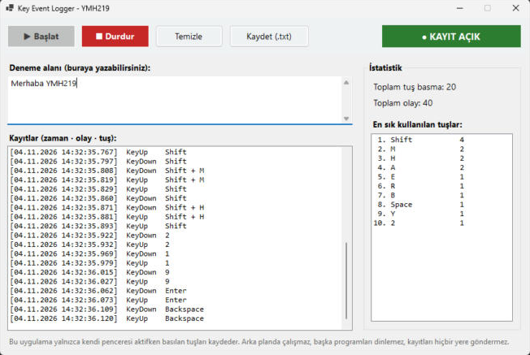
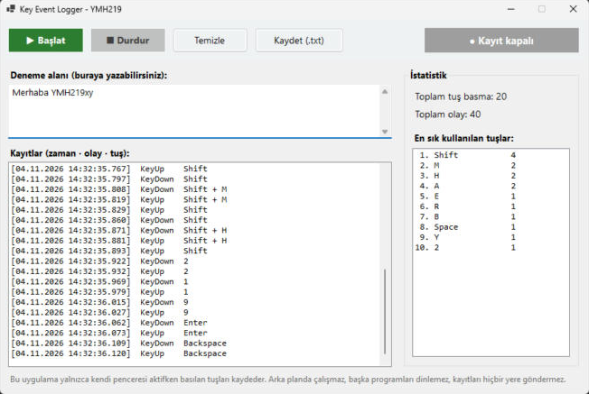
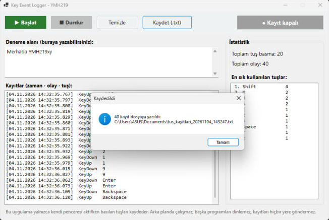
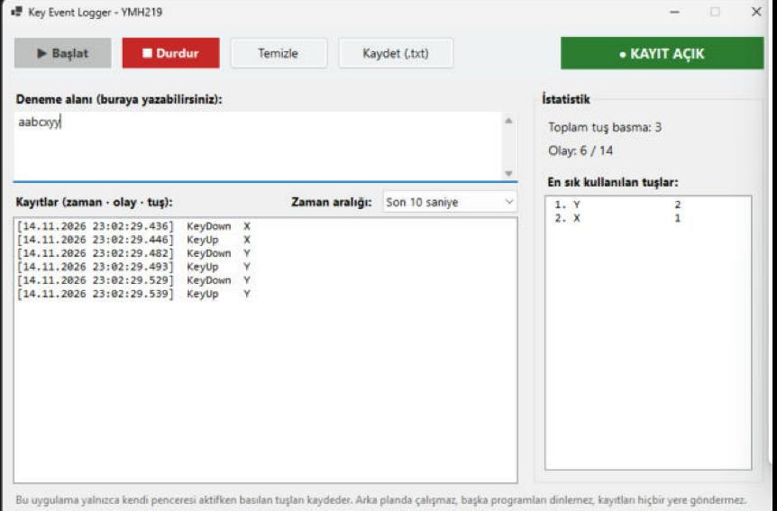

# Key Event Logger (Eğitsel) — YMH219

Klavye olaylarının (KeyDown / KeyUp) Windows Forms'ta nasıl yakalandığını ve işlendiğini gösteren eğitsel bir uygulama. Uygulama **yalnızca kendi penceresi aktifken** basılan tuşları, tarih-saat bilgisiyle birlikte listeler ve kullanıcı isterse bu kayıtları yerel bir `.txt` dosyasına kaydeder.

Bu proje **Nesne Tabanlı Programlama (YMH 219)** dersi ek uygulama ödevi kapsamında hazırlanmıştır.

**Öğrenci:** Yusuf Aslan — **Numara:** 250541068

## Ekran Görüntüleri

| Kayıt açık | Kayıt durduruldu | Dosyaya kaydetme |
|---|---|---|
|  |  |  |

**Zaman aralığı filtresi** — "Son 10 saniye" seçilince yalnızca son 10 saniyedeki olaylar ve bunların istatistiği gösterilir:



## Kapsam ve Güvenlik Sınırı

Bu uygulama gerçek bir sistem keylogger'ı **değildir**:

- Tuşlar yalnızca formun kendi `KeyDown` / `KeyUp` olaylarıyla yakalanır; pencere aktif değilken hiçbir şey kaydedilmez.
- Global keyboard hook, gizli/arka plan çalışma veya Windows açılışında otomatik başlama **yoktur**.
- Başka uygulamalardan veri toplanmaz, parola alanı yoktur.
- Kayıtlar ağ üzerinden hiçbir yere gönderilmez; yalnızca kullanıcının seçtiği yerel dosyaya yazılır.

## Kullanılan Teknolojiler

- C# / .NET 10 (`net10.0-windows`)
- Windows Forms (Form `KeyPreview`, `KeyDown`/`KeyUp` olayları, ListBox, SaveFileDialog)
- Dosya işlemleri: `StreamWriter`
- Harici NuGet paketi kullanılmamıştır.

## Kurulum ve Çalıştırma

1. Depoyu indirin:
   ```bash
   git clone https://github.com/JuseufLeo/YMH219-KeyEventLogger.git
   ```
2. `YMH219-KeyEventLogger.slnx` dosyasını **Visual Studio 2026** ile açın (.NET 10 SDK ve ".NET masaüstü geliştirme" iş yükü gerekir).
3. Yeşil **▶ KeyEventLogger** düğmesine basın (veya `F5`).

Komut satırından:
```bash
dotnet run --project KeyEventLogger
```

## Kullanım

1. **▶ Başlat** ile kaydı açın. Sağ üstteki gösterge yeşil **● KAYIT AÇIK** olur.
2. Pencere aktifken tuşlara basın (deneme alanına yazabilirsiniz). Her olay `[tarih saat] Olay Tuş` biçiminde listelenir.
3. **■ Durdur** ile kaydı kapatın; gösterge gri **● Kayıt kapalı** olur ve yeni tuşlar listeye eklenmez.
4. **Temizle** ekrandaki kayıtları siler, **Kaydet (.txt)** kayıtları dosyaya yazar.
5. **Zaman aralığı** listesinden (Son 10 saniye, Son 30 saniye, Son 1/5/15 dakika) bir seçim yaparak kayıtları süzebilirsiniz. Liste, istatistikler ve kaydedilen dosya seçili aralığa göre olur.

## Özellikler

- KeyDown ve KeyUp olaylarının milisaniyeli zaman bilgisiyle listelenmesi
- Ctrl / Shift / Alt ile yapılan kombinasyonların gösterilmesi (ör. `Shift + M`)
- Başlat / Durdur / Temizle / Kaydet butonları ve renkli kayıt durumu göstergesi
- Kayıtların `.txt` dosyasına kaydedilmesi, dosya hatalarının kullanıcıya mesajla bildirilmesi
- **İstatistik:** toplam tuş basma sayısı, toplam olay sayısı ve en sık kullanılan 10 tuş
- **Zaman aralığı filtresi:** kayıtlar seçilen süreye göre süzülür; aralığın dışına çıkan eski kayıtlar her saniye otomatik olarak listeden düşer

## Proje Yapısı (Sınıflar)

| Dosya | Görevi |
|---|---|
| `KeyEventType.cs` | Olay türü: `KeyDown`, `KeyUp` |
| `KeyLogEntry.cs` | Tek bir kayıt: zaman, tuş, yardımcı tuşlar, olay türü ve okunur tuş adı |
| `KeyLogger.cs` | Kayıt durumu (açık/kapalı), kayıt listesi, istatistikler ve olaylar (`EntryAdded`, `RecordingChanged`) |
| `TimeRangeFilter.cs` | Zaman aralığı seçenekleri (ör. "Son 1 dakika") ve kayıtları bu aralığa göre süzme |
| `LogFileWriter.cs` | Kayıtları `StreamWriter` ile `.txt` dosyasına yazar |
| `MainForm.cs` | Klavye olaylarını `KeyLogger`'a iletir, listeyi ve göstergeyi günceller |

## Bilinen Sınırlamalar / Geliştirme Notları

- Türkçe karakterler (ğ, ş, ı vb.) Windows'un tuş kodu adıyla (ör. `Oem1`) görünebilir; çünkü `KeyDown` olayı karakteri değil fiziksel tuşu verir.
- Uygulama yalnızca kendi penceresi odaktayken çalışır; bu bilinçli bir tasarım tercihidir.
